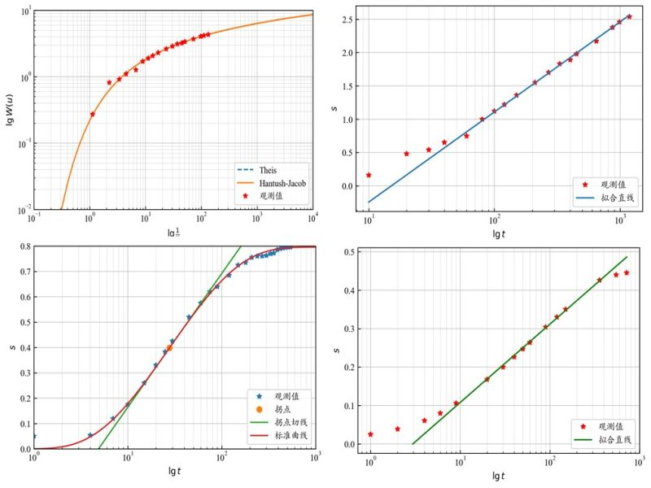

# Pumping Test
This program is applicable for parameter determination using single-well observation data from pumping tests.



本应用提供以下功能：

- **配线法**：用 Theis 或 Hantush-Jacob 公式配线，可以求出 T、S。
- **直线图解法**：用 Jacob 公式配线，可以求出 T、S。
- **拐点法**：用 Hantush-Jacob 曲线拐点性质求参，可以求出 T、S、B。
- **Jacab公式最小二乘法**：根据 Jacob 公式用最小二乘法拟合，可以求出 T、S。

运行:

```
streamlit run main_app.py
```

>
> **说明：**
>
> - 本程序适用于抽水试验的单孔观测数据求参。
> - 数据为 csv 格式, 需包含 4 列数据: 时间(min), 降深(m), 抽水量(m³/min), 观测距离(m); 
> - 可以下载预览中的数据来了解该文件格式。
> - 可以生成 docx 格式文件下载。
>   

可访问 
https://pumpingtest-yanggy1010.streamlit.app/
运行。

# 代码：

## 1\. 主程序

```{python}
"""
抽水试验单孔观测数据求参主程序 main_app.py

MIT License
版权所有 (c) 2025 yanggy (yanggy@cumt.edu.cn)
"""

import streamlit as st

# 设置页面配置
st.set_page_config(page_title="抽水试验单孔数据求参")

# 导入外部模块
from home_page import home_page
from hantush_jacob_fit import hantush_jacob_fit
from inflection import inflection
from jacob_line import jacob_line
from jacob_lstsq import jacob_lstsq

# 页面导航
pages = {
    "程序首页": home_page,
    "配线法": hantush_jacob_fit,
    "直线图解法": jacob_line,
    "拐点法": inflection,
    "Jacab公式最小二乘法": jacob_lstsq,
}

# 初始化当前页面状态
if "current_page" not in st.session_state:
    st.session_state.current_page = "程序首页"

# 页面选择器
selected_page = st.sidebar.selectbox("选择求参方法", list(pages.keys()))
if selected_page != st.session_state.current_page:
    st.session_state.current_page = selected_page
    st.rerun()  # 重新运行以加载新页面

# 显示当前页面
pages[st.session_state.current_page]()
```

## 2\. 程序首页

```{python}
"""
抽水试验单孔数据求参程序首页 home_page.py

MIT License
版权所有 (c) 2025 yanggy (yanggy@cumt.edu.cn)
"""

import streamlit as st
import os

def home_page():
    st.markdown("### 抽水试验单孔观测数据求参方法")
    st.write("欢迎使用抽水试验求参分析工具, 左侧选项卡可以选择不同方法。")

    st.write("本应用提供以下功能：")
    st.markdown("""
    - **配线法**：用 Theis 或 Hantush-Jacob 公式配线，可以求出 T、S。
    - **直线图解法**：用 Jacob 公式配线，可以求出 T、S。
    - **拐点法**：用 Hantush-Jacob 曲线拐点性质求参，可以求出 T、S、B。
    - **Jacab公式最小二乘法**：根据 Jacob 公式用最小二乘法拟合，可以求出 T、S。
    >
    > **说明：**
    >
    > - 本程序适用于抽水试验的单孔观测数据求参。
    > - 数据为 csv 格式, 需包含 4 列数据: 时间(min), 降深(m), 抽水量(m³/min), 观测距离(m); 
    > - 可以下载预览中的数据来了解该文件格式。
    > - 可以生成 docx 格式文件下载。
    >
    """)

    img = os.path.join(os.path.dirname(__file__), "images", "tools-800x600.jpg")
    st.image(img)
```

## 3\. Theis 与 Hantush-Jacob 配线法 
```{python}
"""
Theis 与 Hantush-Jacob 配线法求参程序 hantush_jacob_fit.py

MIT License
版权所有 (c) 2025 yanggy (yanggy@cumt.edu.cn)
"""

import matplotlib.pyplot as plt
from matplotlib import font_manager
import numpy as np
import pandas as pd
import streamlit as st
from docx import Document
from docx.shared import Inches
from io import BytesIO
import os
from itertools import zip_longest

from scipy.special import expn, k0, exp1 as theis_well

# 配置字体和全局参数
py_path = os.path.dirname(__file__)
font_mapping = {
    "simkai.ttf": "KaiTi", 
    "simhei.ttf": "simhei",         
    "simfang.ttf": "FangSong"  
}
loaded_font_families = ['Times New Roman']
for font_file, font_family in font_mapping.items():
    font_path = os.path.join(py_path, "fonts", font_file)
    if os.path.exists(font_path):
        font_manager.fontManager.addfont(font_path)
        loaded_font_families.append(font_family)
        # break
plt.rcParams['font.family'] = loaded_font_families
plt.rcParams['axes.unicode_minus'] = False
plt.rcParams['xtick.direction'] = 'in'
plt.rcParams['ytick.direction'] = 'in'

# Hantush-Jacob 井函数计算
def hantush_jacob_well(u, beta):
    """计算 Hantush-Jacob 井函数。"""
    def wellfunc(u, beta):
        if u < 0:
            raise ValueError("Negative values for 'u' are not allowed.")
        if u == 0:
            return 2.0 * k0(beta)
        r, b, t = 1.0, 2 * u, beta**2 / (4 * u)
        W, n = 0.0, 0
        if beta <= b:
            term = r * expn(n + 1, u)
            while np.abs(term) > 1e-10:
                W += term
                n += 1
                r *= -t / n
                term = r * expn(n + 1, u)
        else:
            W = 2.0 * k0(beta)
            term = r * expn(n + 1, t)
            while np.abs(term) > 1e-10:
                W -= term
                n += 1
                r *= -u / n
                term = r * expn(n + 1, t)
        return W
    return np.vectorize(wellfunc)(u, beta)

def calc_init_params(t, s, Q, r):
    """按 Jacob 公式计算参数。"""
    idx = np.argmin(np.abs(t / t[-1] - 0.5)) - 1
    slope = (s[idx] - s[idx + 1]) / np.log10(t[idx] / t[idx + 1])
    T = 0.183 * Q / slope
    t0 = t[idx] * 10**(-s[idx] / slope)
    S = 2.25 * T * t0 / r**2
    dx = np.log10(4 * T / (S * r**2))
    dy = np.log10(4 * np.pi * T / Q)
    return T, S, dx, dy

# 生成Word文档
def create_report(T, S, B, fig, filename="report.docx"):
    """生成Word文档"""
    doc = Document()
    doc.add_heading("配线法求参", level=1)
    doc.add_paragraph(f"导水系数 T = {T:.4e} m²/min")
    doc.add_paragraph(f"贮水系数 S = {S:.4e}")
    doc.add_paragraph(f"越流因素 B = {B:.4e} m")

    img_buffer = BytesIO()
    fig.savefig(img_buffer, dpi=300, format="png", bbox_inches="tight")
    img_buffer.seek(0)
    doc.add_picture(img_buffer, width=Inches(6))
    
    report_buffer = BytesIO()
    doc.save(report_buffer)
    report_buffer.seek(0)
    return report_buffer

# 主程序
def hantush_jacob_fit():
    st.markdown("### Theis 与 Hantush-Jacob 配线法")

    t = np.array([1, 2, 4, 6, 9, 20, 30, 40, 50, 60, 
                  90, 120, 150, 360, 550, 720])  # min
    s = np.array([2.5, 3.9, 6.1, 8.0, 10.6, 16.8, 20.0, 22.6, 24.7, 26.4,
                  30.4, 33.0, 35.0, 42.6, 44.0, 44.5]) / 100   # m
    Q = 0.3667  # 528/1440, m³/min
    r = 90      # m

    data = [t, s, [Q], [r]]
    transposed_data = list(map(list, zip_longest(*data, fillvalue=None)))
    df = pd.DataFrame(transposed_data, columns=['t', 's', 'Q', 'r'])

    # 上传数据
    uploaded_file = st.sidebar.file_uploader(
        "上传 CSV 文件", 
        type=["csv"])

    if uploaded_file:
        df = pd.read_csv(uploaded_file)
        t = df['t'].values   # 时间
        s = df['s'].values   # 降深
        Q = df['Q'].iloc[0]  # 抽水量
        r = df['r'].iloc[0]  # 观测距离
    
    st.sidebar.write("CSV数据预览:")
    st.sidebar.dataframe(df, height=150, width=400, hide_index=True) 

    T, S, dx, dy = calc_init_params(t, s, Q, r)
    dx = st.sidebar.slider(r"$\Delta \lg t$", dx-0.5, dx+0.5, dx, 0.01, format="%.3f")
    dy = st.sidebar.slider(r"$\Delta \lg s$", dy-0.5, dy+0.5, dy, 0.01, format="%.3f")
    beta = st.sidebar.slider(r'$\beta$', 0.0, 2.0, 0.0, step=0.01, format="%.3f")

    help_txt = '''
        - 通过滑块平移图形配线;
        - 数据为 csv 格式, 需包含 4 列数据: 时间(min), 降深(m), 抽水量(m³/min), 观测距离(m); 
        可下载预览中的数据来了解该文件格式。 
        '''
    with st.sidebar:
        st.markdown(help_txt)

    # 计算和绘图
    fig, ax = plt.subplots(dpi=150)
    ax.set(xscale="log", yscale="log", xlim=(1.0e-1, 1.0e4), ylim=(1.0e-2, 10.0),
           xlabel=r'$\lg \frac{1}{u}$', ylabel=r'$\lg W(u)$')
    ax.grid(True, which="major", linestyle="-", linewidth=0.5)
    ax.grid(True, which="minor", linestyle="-", linewidth=0.2)
    ax.set_aspect('equal')

    t_ = 10**np.linspace(-1, 4, 51)
    ax.plot(t_, theis_well(1 / t_), label="Theis", linestyle="--")
    ax.plot(t_, hantush_jacob_well(1 / t_, beta), label="Hantush-Jacob")
    ax.plot(t * 10**dx, s * 10**dy, "r*", label="观测值")
    ax.legend(loc=4)

    st.pyplot(fig)

    # 计算水文参数
    T = Q / (4 * np.pi) * 10**dy
    S = 4 * T / r**2 * 10**(-dx)
    st.write(f'T = {T:.4f} m^2/min, S = {S:.4e}')
    if beta > 0:
        B = r / beta
    else:
        B = float('inf')
    st.write(f'B = {B:.4e}')

    # 生成Word文档
    if st.button("Word文档"):
        report = create_report(T, S, B, fig)
        st.download_button(
            label="下载文档",
            data=report,
            file_name="report.docx",
            mime="application/vnd.openxmlformats-officedocument.wordprocessingml.document"
        )

# 运行程序
if __name__ == "__main__":
    hantush_jacob_fit()
```

## 4\. Jacob 直线图解法求参程序 
```{python}
"""
Jacob 直线图解法求参程序 jacob_line.py

MIT License
版权所有 (c) 2025 yanggy (yanggy@cumt.edu.cn)
"""

import matplotlib.pyplot as plt
from matplotlib import font_manager
import numpy as np
import pandas as pd
import streamlit as st
from docx import Document
from docx.shared import Inches
from io import BytesIO
import os
from itertools import zip_longest

# 配置字体和全局参数
py_path = os.path.dirname(__file__)
font_mapping = {
    "simkai.ttf": "KaiTi", 
    "simhei.ttf": "simhei",         
    "simfang.ttf": "FangSong"  
}
loaded_font_families = ['Times New Roman']
for font_file, font_family in font_mapping.items():
    font_path = os.path.join(py_path, "fonts", font_file)
    if os.path.exists(font_path):
        font_manager.fontManager.addfont(font_path)
        loaded_font_families.append(font_family)
        # break
plt.rcParams['font.family'] = loaded_font_families
plt.rcParams['axes.unicode_minus'] = False
plt.rcParams['xtick.direction'] = 'in'
plt.rcParams['ytick.direction'] = 'in'

# 计算初始参数
def calc_init_param(t, s):
    """按 Jacob 公式计算参数。"""
    idx = np.argmin(np.abs(t / t[-1] - 0.5)) - 1
    slope = (s[idx] - s[idx + 1]) / np.log10(t[idx] / t[idx + 1])
    t0 = t[idx] * 10**(-s[idx] / slope)
    return t0, slope

# 生成Word文档
def create_report(T, S, fig, filename="report.docx"):
    """生成Word文档"""
    doc = Document()
    doc.add_heading("直线图解法求参", level=1)
    doc.add_paragraph(f"导水系数 T = {T:.4e} m²/min")
    doc.add_paragraph(f"贮水系数 S = {S:.4e}")
    
    img_buffer = BytesIO()
    fig.savefig(img_buffer, dpi=300, format="png", bbox_inches="tight")
    img_buffer.seek(0)
    doc.add_picture(img_buffer, width=Inches(6))
    
    report_buffer = BytesIO()
    doc.save(report_buffer)
    report_buffer.seek(0)
    return report_buffer

# 主程序
def jacob_line():
    st.markdown("### Jacob直线图解法求参")

    t = np.array([1, 2, 4, 6, 9, 20, 30, 40, 50, 60, 
                  90, 120, 150, 360, 550, 720])  # min
    s = np.array([2.5, 3.9, 6.1, 8.0, 10.6, 16.8, 20.0, 22.6, 24.7, 26.4,
                  30.4, 33.0, 35.0, 42.6, 44.0, 44.5]) / 100   # m
    Q = 0.3667  # 528/1440, m³/min
    r = 90      # m

    data = [t, s, [Q], [r]]
    transposed_data = list(map(list, zip_longest(*data, fillvalue=None)))
    df = pd.DataFrame(transposed_data, columns=['t', 's', 'Q', 'r'])

    # 上传数据
    uploaded_file = st.sidebar.file_uploader(
        "上传 CSV 文件", 
        type=["csv"])

    if uploaded_file:
        df = pd.read_csv(uploaded_file)
        t = df['t'].values   # 时间
        s = df['s'].values   # 降深
        Q = df['Q'].iloc[0]  # 抽水量
        r = df['r'].iloc[0]  # 观测距离
    
    st.sidebar.write("CSV数据预览:")
    st.sidebar.dataframe(df, height=200, width=400, hide_index=True) 

    t0, slope = calc_init_param(t, s)
    t0 = st.sidebar.slider(r'$t_0$', t0/3, t0*3, t0, t0/50, format="%.3f")
    slope = st.sidebar.slider(r'$i$', slope/3, slope*3, slope, slope/50, format="%.3f")

    help_txt = '''
        - 通过滑块调整零降深时间与直线斜率;
        - 抽水初始阶段不满足 u 比较小的条件, 这些观测数据不能用;
        - 长时间抽水, 降落漏斗扩展到边界, 后期降深变化平缓的观测数据不能用。
        - 数据为 csv 格式, 需包含 4 列数据: 时间(min), 降深(m), 抽水量(m³/min), 观测距离(m); 
        可下载预览中的数据来了解该文件格式。 
        '''
    with st.sidebar:
        st.markdown(help_txt)

    # 计算和绘图
    T = 0.183 * Q / slope
    S = 2.25 * T * t0 / r**2 

    fig, ax = plt.subplots(figsize=(6, 4), dpi=150)
    ax.set(xscale="log", xlabel=r'$\lg t$', ylabel=r'$s$')
    ax.grid(True, which="major", linestyle="-", linewidth=0.5)
    ax.grid(True, which="minor", linestyle="-", linewidth=0.2)
    ax.plot(t, s, "r*", label="观测值")

    t_ = np.linspace(min(t), max(t), 50)
    s_ = slope * np.log10(t_ / t0)
    ax.plot(t_, s_, label="拟合直线")
    ax.legend(loc=4)

    st.pyplot(fig)
    st.write(f'T = {T:.4f} m²/min, S = {S:.4e}')

    # 生成Word文档
    if st.button("Word文档"):
        report = create_report(T, S, fig)
        st.download_button(
            label="下载文档",
            data=report,
            file_name="report.docx",
            mime="application/vnd.openxmlformats-officedocument.wordprocessingml.document"
        )

# 运行程序
if __name__ == "__main__":
    jacob_line()
```

## 5\. 拐点法求参程序
```{python}
"""
拐点法求参程序 inflection.py

MIT License
版权所有 (c) 2025 yanggy (yanggy@cumt.edu.cn)
"""

import matplotlib.pyplot as plt
from matplotlib import font_manager
import numpy as np
import pandas as pd
import streamlit as st
from docx import Document
from docx.shared import Inches
from io import BytesIO
import os
from itertools import zip_longest

from scipy.special import expn, k0
from scipy.optimize import bisect

# 配置字体和全局参数
py_path = os.path.dirname(__file__)
font_mapping = {
    "simkai.ttf": "KaiTi", 
    "simhei.ttf": "simhei",         
    "simfang.ttf": "FangSong"  
}
loaded_font_families = ['Times New Roman']
for font_file, font_family in font_mapping.items():
    font_path = os.path.join(py_path, "fonts", font_file)
    if os.path.exists(font_path):
        font_manager.fontManager.addfont(font_path)
        loaded_font_families.append(font_family)
        # break
plt.rcParams['font.family'] = loaded_font_families
plt.rcParams['axes.unicode_minus'] = False
plt.rcParams['xtick.direction'] = 'in'
plt.rcParams['ytick.direction'] = 'in'

# Hantush-Jacob 井函数计算
def hantush_jacob_well(u, beta):
    """计算 Hantush-Jacob 井函数。"""
    def wellfunc(u, beta):
        if u < 0:
            raise ValueError("Negative values for 'u' are not allowed.")
        if u == 0:
            return 2.0 * k0(beta)
        r, b, t = 1.0, 2 * u, beta**2 / (4 * u)
        W, n = 0.0, 0
        if beta <= b:
            term = r * expn(n + 1, u)
            while np.abs(term) > 1e-10:
                W += term
                n += 1
                r *= -t / n
                term = r * expn(n + 1, u)
        else:
            W = 2.0 * k0(beta)
            term = r * expn(n + 1, t)
            while np.abs(term) > 1e-10:
                W -= term
                n += 1
                r *= -u / n
                term = r * expn(n + 1, t)
        return W
    return np.vectorize(wellfunc)(u, beta)

def calc_init_params(t, s):
    """按 Jacob 公式计算参数。"""
    sp = 0.5 * s[-1]
    idx = np.where(s > sp)[0][0] - 1
    tp = t[idx]
    slope = (s[idx] - s[idx + 1]) / np.log10(t[idx] / t[idx + 1])
    return sp, tp, slope

# 生成Word文档
def create_report(T, S, B, fig, filename="report.docx"):
    """生成Word文档"""
    doc = Document()
    doc.add_heading("配线法求参", level=1)
    doc.add_paragraph(f"导水系数 T = {T:.4e} m²/min")
    doc.add_paragraph(f"贮水系数 S = {S:.4e}")
    doc.add_paragraph(f"越流因素 B = {B:.4e} m")

    img_buffer = BytesIO()
    fig.savefig(img_buffer, dpi=300, format="png", bbox_inches="tight")
    img_buffer.seek(0)
    doc.add_picture(img_buffer, width=Inches(6))
    
    report_buffer = BytesIO()
    doc.save(report_buffer)
    report_buffer.seek(0)
    return report_buffer

# 主程序
def inflection():
    st.markdown("### 拐点法求参")

    t = np.array([1, 4, 7, 10, 15, 20, 25, 30, 45, 60, 
                  75, 90, 120, 150, 180, 210, 240, 270, 300, 330,
                  360, 390, 420, 450, 480, 510, 540])
    s = np.array([0.05, 0.054, 0.12, 0.175, 0.26, 0.33, 0.383, 0.425, 0.52, 
                  0.575, 0.62, 0.64, 0.685, 0.725, 0.735, 0.755, 0.76, 0.76,
                  0.763, 0.77, 0.772, 0.785, 0.79, 0.792, 0.794, 0.795, 0.796])
    Q = 69.1 / 60  # m³/min
    r = 197.0      # m

    data = [t, s, [Q], [r]]
    transposed_data = list(map(list, zip_longest(*data, fillvalue=None)))
    df = pd.DataFrame(transposed_data, columns=['t', 's', 'Q', 'r'])

    # 上传数据
    uploaded_file = st.sidebar.file_uploader(
        "上传 CSV 文件", 
        type=["csv"])

    if uploaded_file:
        df = pd.read_csv(uploaded_file)
        t = df['t'].values   # 时间
        s = df['s'].values   # 降深
        Q = df['Q'].iloc[0]  # 抽水量
        r = df['r'].iloc[0]  # 观测距离
    
    st.sidebar.write("CSV数据预览:")
    st.sidebar.dataframe(df, height=200, width=400, hide_index=True) 

    sp, tp, slope = calc_init_params(t, s)

    tp = st.sidebar.slider(r'$t_p$', float(tp/3), float(tp*3), float(tp), float(tp/50), format="%.3f")
    sp = st.sidebar.number_input(r'$s_p$', float(sp), float(sp*2), float(sp), format="%.3f")
    slope = st.sidebar.slider(r'$i$', float(slope/3), float(slope*3), float(slope), float(slope/50), format="%.3f")

    help_txt = '''
        - 通过滑块调整拐点与切线斜率;
        - 拐点降深需要输入;
        - 数据为 csv 格式, 需包含 4 列数据: 时间(min), 降深(m), 抽水量(m³/min), 观测距离(m); 
        可下载预览中的数据来了解该文件格式。 
        '''
    with st.sidebar:
        st.markdown(help_txt)

    # 计算和绘图
    beta = bisect(lambda x: np.exp(x) * k0(x) - 2.3 * sp / slope, 0.001, 5)
    T = 2.3 * Q * np.exp(-beta) / (4 * np.pi * slope)
    S = 2 * T * tp * beta / r**2
    B = r / beta

    fig, ax = plt.subplots(figsize=(6, 4), dpi=150)
    ax.plot(t, s, '*', label="观测值")
    ax.plot(tp, sp, 'o', label="拐点")
    x_log_min = np.floor(np.log10(min(t)))
    x_log_max = np.ceil(np.log10(max(t)))
    t_ = 10**np.linspace(x_log_min, x_log_max, 100)
    ax.plot(t_, sp + slope * np.log10(t_ / tp), label="拐点切线")
    u = 0.25 * r**2 * S / (T * t_)
    ax.plot(t_, 0.25 * Q * hantush_jacob_well(u, beta) / (np.pi * T), 
            label="标准曲线", linestyle="-")
    
    ax.set(xscale="log", 
           xlim=(10**x_log_min, 10**x_log_max), 
           ylim=(0, np.ceil(max(s) * 10) / 10),
                  xlabel=r'$\lg t$',
           ylabel=r'$s$'
    )

    ax.grid(True, which="major", linestyle="-", linewidth=0.5)
    ax.grid(True, which="minor", linestyle="-", linewidth=0.2)
    ax.legend(loc=4)
    
    st.pyplot(fig)
    st.write(f'T = {T:.4f} m²/min, S = {S:.4e}, B = {B:.4e} m')

    # 生成Word文档
    if st.button("Word文档"):
        report = create_report(T, S, B, fig)
        st.download_button(
            label="下载文档",
            data=report,
            file_name="report.docx",
            mime="application/vnd.openxmlformats-officedocument.wordprocessingml.document"
        )

# 运行程序
if __name__ == "__main__":
    inflection()
```

